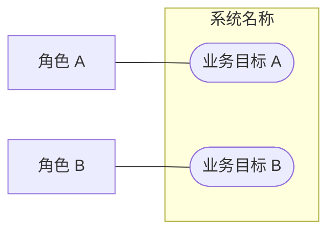

# [项目或需求名称] PRD

<!-- 编写提示：第一版草稿就要移除本提示、填写说明、引导问题、占位符和模板示例。保留适用的标题及字段，去掉“可选”“必填”“按需填写”等标记。不涉及的可选部分整块省略；必填信息缺失时先澄清。 -->

所属项目：[项目名]｜目标版本：[版本号]

负责人：[姓名]｜最近更新：[YYYY-MM-DD]

关联资料（可选）：[原型或相关文档链接]

### 修改记录

| 文档版本 | 修改日期 | 修改人 | 影响章节 | 变更摘要 |
| --- | --- | --- | --- | --- |
| [版本号] | [YYYY-MM-DD] | [姓名] | [章节编号及名称] | 1. [主要改动] 2. [另一项独立改动，如有] |

第一版登记为 v1.0，摘要写“初版”，正文不加版本号前缀。以后每批改动在确认写入时登记一次，版本号依次升为 v1.1、v1.2……。同一批改动的草稿不单独登记。保留历次记录和正文中的旧版本标注。

每批改动占一行。摘要里逐项编号，每项一句，在同一单元格内用 ` ` 换行。同一变化只写一次，涉及的章节列在“影响章节”栏。

修改正文时，使用与本次记录相同的版本号：

- 替换：按 `~~失效的原文~~ v版本号：新规则` 标注，只划掉失效的部分。
- 新增：以版本号开头，紧接着写新增内容。
- 取消：划掉旧规则，在版本号后写明取消了什么。

凡是引用了这条规则的验收标准，也要一起改。写法见[修订记录正反例](./文档写作正反例.md#修订记录)。成稿时保留修改记录表，移除填写说明和示例。

### 词汇说明（可选）

只列读者可能不熟悉的新名词、专业术语或缩写。

- **[词汇]**：[一句话说明它在本需求中的含义；缩写注明全称。]

## 1. 背景与目标

[谁在做什么时遇到了问题？希望改善到什么程度？]

## 2. 需求范围

- 本期做：
- 本期不做：

### 用例图（必填）

谁会用，用来做什么。

## 3. 能力边界

| 模块 | 功能与规则 | 职责边界 |
| --- | --- | --- |
| [名称] | [支持哪些操作，有什么限制] | [负责到哪一步，后续由谁接手] |

步骤或分支用文字说不清时，可在对应功能下补一张流程图。画法见[需求分析图表规范](./需求分析图表规范.md)。

## 4. 异常处理

| 异常场景 | 处理方式 | 对用户的影响（如有） |
| --- | --- | --- |
| [何时出错] | [如何处理，保留哪些数据或状态] | [提示什么，用户能怎么做] |

## 5. 非功能需求（按需填写）

- 响应时间与并发量：[同时有多少用户执行什么操作，响应时间应在多久以内。]
- 兼容性：[需要支持哪些平台、设备或浏览器版本。]

## 6. 验收标准

逐条写清怎样才算满足这项规则，正常和异常情况都要覆盖。

- [ ] 在[条件]下执行[操作]，应得到[结果]。
