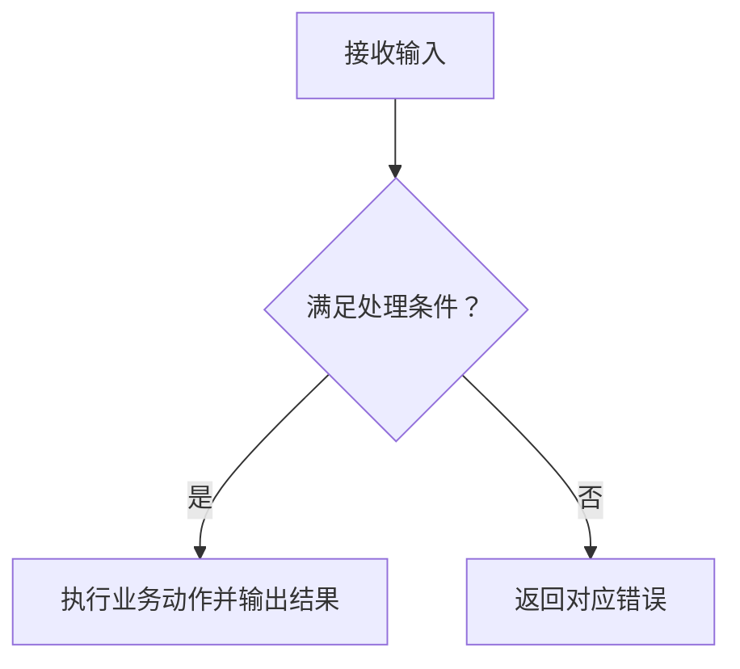
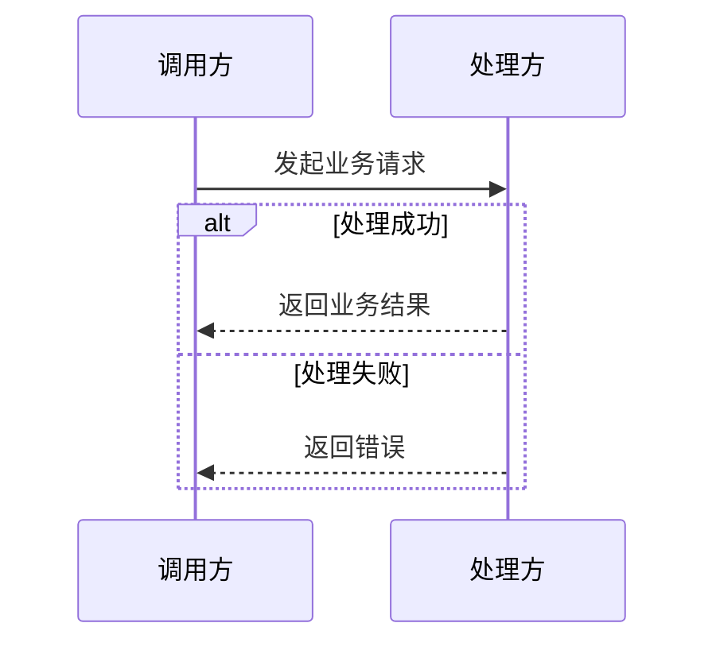

# [项目名称] 技术方案

对应 PRD：[文档链接、文档版本、相关章节]｜本次范围：[前端、后端或全栈]

<!-- 初版写本项目的完整设计。迭代只保留受影响的章节、模块和端，链接仍适用的旧设计。成稿移除填写说明、占位符和示意图，换成真实设计。 -->

## 1. 技术栈与选型

| 端 | 关键技术 | 用途 | 为什么选它 |
| --- | --- | --- | --- |
| [所属端] | [技术名称] | [解决什么问题] | [结合项目约束说明理由及取舍] |

初版写明关键选型；迭代只有技术栈发生变化时才写，说明替换原因和影响。

## 2. 架构设计

用 Mermaid 架构图标出本次涉及的端、组件、外部依赖及调用方向。区分已有组件和本次改动，不用目录树代替架构图。

在图下解释为什么这样划分模块、确定数据归属或安排部署，写出影响选择的业务或交付限制。如果已有业务依据表明未来 1–2 年可能需要调整，说明会改到哪些模块。现在预留扩展，就写清做法和代价。留到以后处理，就写清何时再评估。增长规模和扩展需求要有依据。

## 3. 项目目录

按端列出目录树，在关键路径旁写明用途。初版展示主要目录；迭代只列新增、调整或移除的路径及其影响。

Java 后端从工程根目录标出启动入口、业务模块、对外契约、共用组件和测试的实际位置，再展开本次涉及的业务包。配置、映射或迁移脚本有变化时一并标出。目录较长时，正文保留关键路径，链接到完整目录。包名、测试位置和两级目录示例见[Java 工程目录与分层](./Java工程目录与分层.md)。

## 4. 业务模块设计

### [模块名称]

**功能边界**：[本模块负责哪些操作，到哪一步结束；哪些工作由其他模块接手。全栈模块分别说明前后端职责。]

| 输入及来源 | 处理条件 | 输出及去向 |
| --- | --- | --- |
| [谁传入哪些数据或事件] | [触发条件、校验规则] | [结果、状态变化或错误，交给谁] |

**模块内流程**：画出本模块的处理步骤，标明在哪里做判断、出错后怎么处理、流程何时结束。

**数据模型**

- 前端：写明页面或组件需要的数据、状态及更新条件。前后端模型有差异时，说明字段映射。
- 后端：涉及数据库设计时，必须提供 Mermaid 数据库 ER 图（`erDiagram`）。图中用“表名（中文业务名）”标识实体，展示所设计表的全部字段、类型和中文含义，标记主键、关联字段及单字段唯一键，标明关系两端的最小和最大基数。字段的非空、默认值、枚举和单位在图中注释或图下说明；联合唯一键、索引及复杂约束在图下列出。图与数据字典、DDL 保持一致。画法和示例见[需求分析图表规范](./需求分析图表规范.md)。

初版画出模块涉及的表及其关系；迭代中表结构或关系有变化时，只画受影响的表及理解变化所需的关联表。数据库设计未变时不重复绘图。纯前端模块省略后端部分。

**接口设计**：按模块列出提供或调用的接口。纯前端模块不发网络请求时，组件参数、事件和回调写在模块输入输出中，省略接口清单。

| 接口 | 方法与路径 | 调用方 → 提供方 | 用途 |
| --- | --- | --- | --- |
| [名称] | [方法、路径] | [双方] | [业务动作] |

每个接口只维护一份定义，写清请求参数、成功响应和失败响应。已有完整契约就链接到对应接口，正文只交代改了什么、对调用方有什么影响，以及关键操作失败时会返回什么。

| 请求参数 | 位置 | 类型 | 必填 | 含义与约束 |
| --- | --- | --- | --- | --- |
| [参数名] | [路径、查询、请求头或请求体] | [类型] | [是或否] | [取值及校验条件] |

成功响应：[返回字段、类型及业务含义]。失败响应：[触发条件、错误码及调用方如何处理]。

## 5. 关键交互

按业务场景画 Mermaid 时序图，可跨模块引用上面的接口。图中写清谁发起、先调什么、结果返回给谁；有失败分支、异步通知时按实际顺序画出。

## 6. 性能设计

按涉及的端说明关键场景、瓶颈、措施和验证方法。前端可关注加载与渲染，后端可关注查询与并发。有明确指标就写达标条件，没有实测数据不写性能收益。

## 7. 实施与验证

列出本次实施顺序、依赖、需要验证的关键路径和异常场景，与对应 PRD 的验收标准对照。

涉及存量迁移时，生成方案必须说明以下路径，并分别列出验收场景：

- 对已受理但尚未执行、执行结果未知和已完成的业务，分别说明接管方、接管条件及后续动作。停用旧任务前明确未执行任务如何继续提交；结果未知时写明查询、重试或人工处理的条件，并按外部契约保持原请求标识和参数的幂等性。
- 对迁移期间及迁移后新增的业务，说明必要数据由谁初始化、何时提交以及满足什么条件后可用。初始化和存量回填并发时，明确如何识别已有记录与占用，防止重复创建或覆盖历史数据。
- 对新旧流程共享的额度、库存等资源，说明统一校验与占用方式，以及切换回退后已受理业务由谁继续处理、占用如何保留和释放。

Java 后端交付前，用目录树、架构图和调用时序图交叉核对包路径、模块职责及依赖方向。有接口变更时核对前后端规约、错误码和异常处理；涉及 MySQL 时，用建表、索引与 ORM 映射规约核对 ER 图和数据字典。
