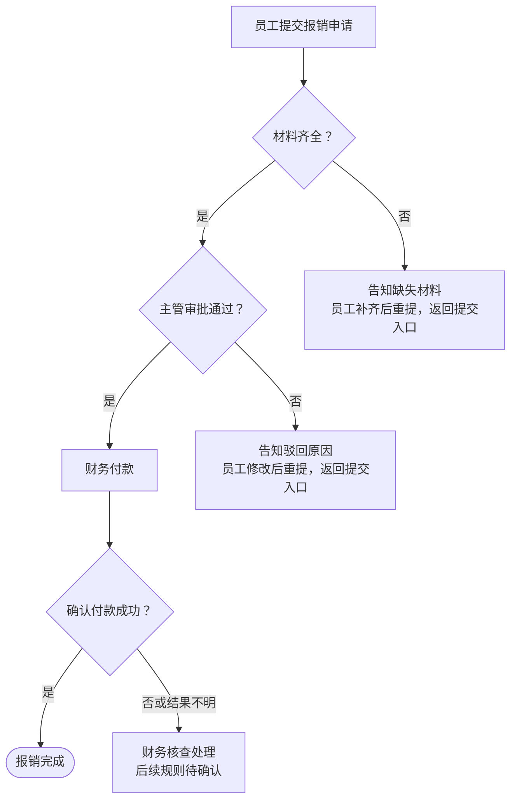
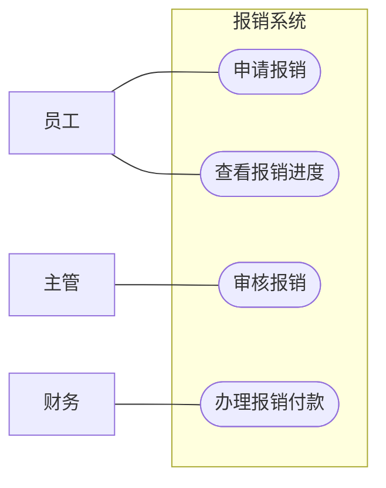
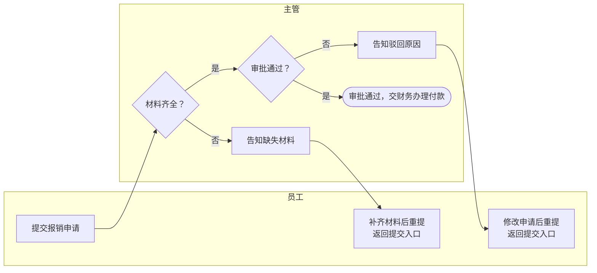
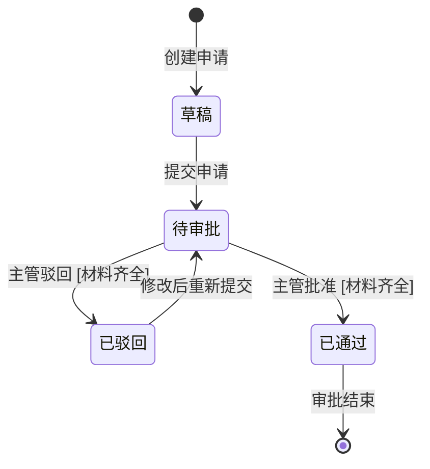
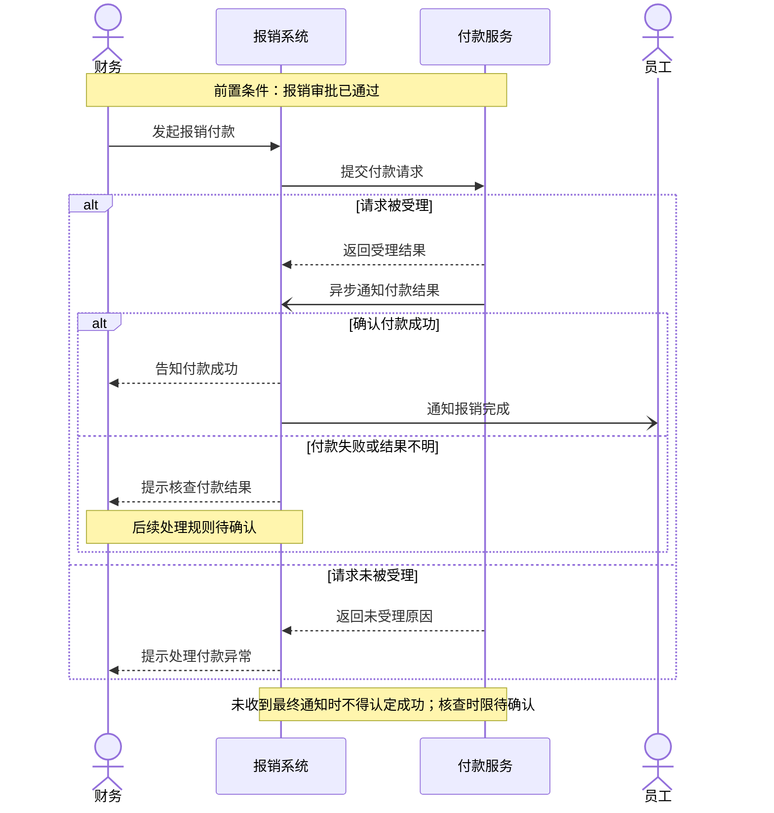
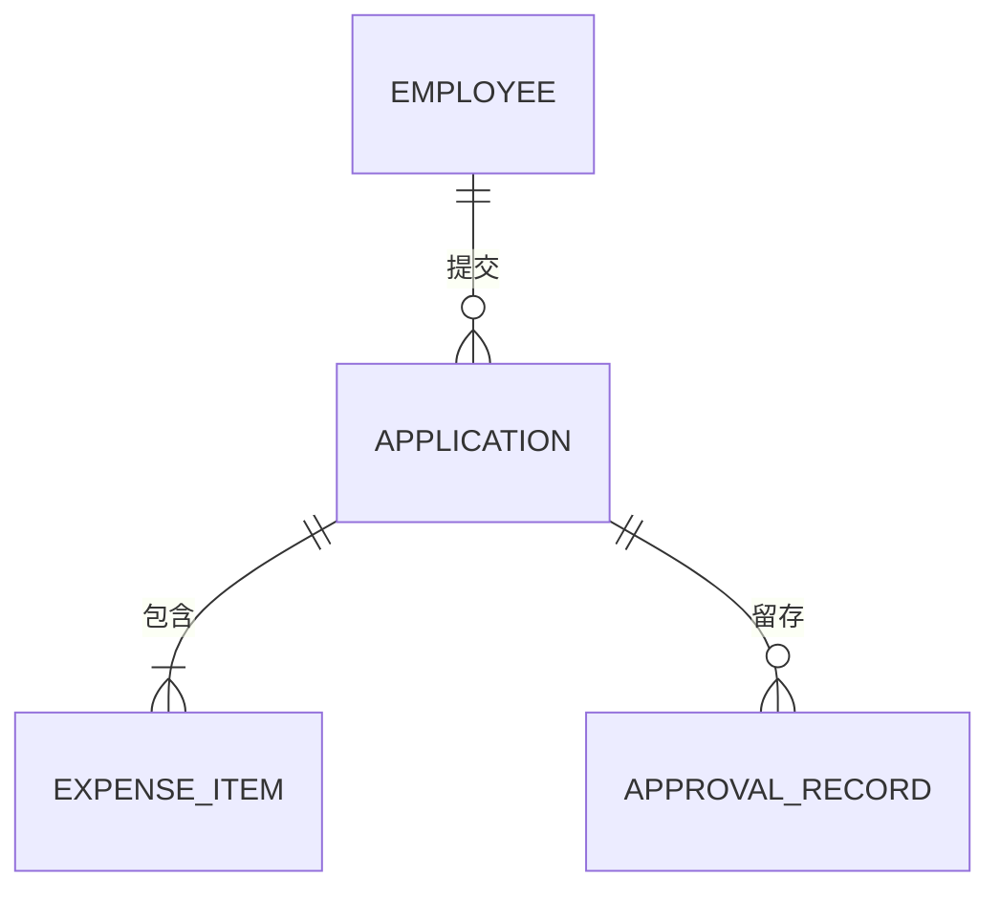
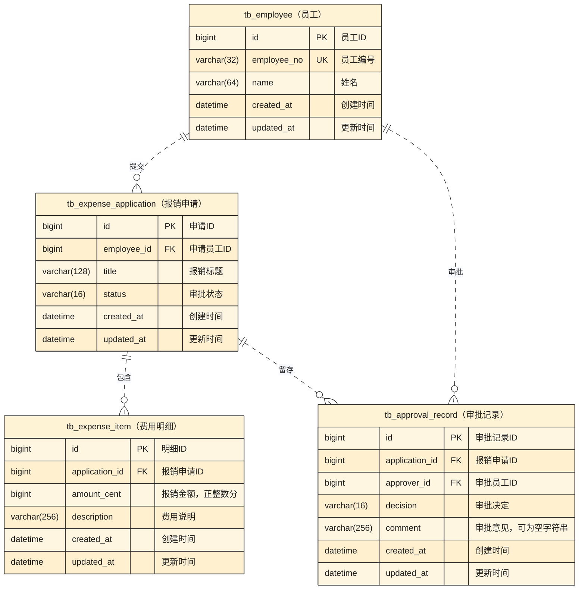

# 需求分析图表规范

## 1. 基本原则

- 使用 Mermaid 绘图，源码随需求文档维护。
- 每张图有明确的重点，图中的业务规则与对应需求、验收用例一致。
- 可读性优先，保持简洁。不要求每个功能绘制全套图。
- 角色名、对象名、状态名与需求文档一致。未知规则标注“待确认”，不得用连线补造规则。

## 2. 图表选用

| 图类型 | 回答的问题 | 主要内容 |
| --- | --- | --- |
| 用例总览 | 谁会用，用来做什么？ | 主要角色和用例 |
| 业务流程图／活动图 | 事情怎样完成，不同情况如何处理？ | 入口、动作、判断、分支、结果 |
| 泳道图 | 每一步由谁负责？ | 职责分区、动作、交接关系 |
| 状态图 | 一项状态属性如何变化？ | 状态、事件、条件、终态 |
| 时序图 | 多个参与方按什么顺序交互？ | 参与方、消息、响应、交互约束 |
| 概念 ER 图 | 有哪些业务对象，它们如何关联？ | 实体、业务关系、关系基数 |
| 数据库 ER 图 | 业务对象如何落表，表之间通过哪些字段关联？ | 表名、完整字段、类型、字段含义、键和关系基数 |

通常先整理用例总览、核心业务流程、业务规则与验收标准，再按需要补充其他图。

概念 ER 图用于需求分析；数据库 ER 图用于数据库设计或既有数据模型说明，不要求在需求尚未明确时提前设计表结构。

Mermaid 脑图或流程图可用于用例总览，但不等同于标准 UML 用例图；使用分区表达职责时，应明确其为泳道式表达。

## 3. 业务流程图

### 3.1 业务表达

- 正文没交代清楚时，在图前补充流程的起点、结果或假设。
- 动作使用“动词＋对象”，如“提交申请”“审核报销”；需要时注明执行角色。
- 判断使用可判定的问题，如“材料齐全？”。出口注明“是／否”或互斥且完整的条件。
- 标明图中各分支的去向；流程允许重试或重提时，说明从哪一步继续。
- 保持业务层级，不混入 Controller、接口调用、数据库更新等实现细节。
- 并行任务明确分叉和汇合条件，不以多条普通箭头暗示并行。
- 复杂环节可拆成子流程。金额、期限、权限等规则在正文说明，需要跨处引用时再编号。

### 3.2 符号

| 含义 | 图形 | Mermaid 写法 |
| --- | --- | --- |
| 开始／结束 | 圆角终止符 | `A([开始])` |
| 业务动作 | 矩形 | `A[提交申请]` |
| 条件判断 | 菱形 | `A{材料齐全？}` |
| 输入／输出 | 平行四边形 | `A[/接收申请数据/]` |
| 流程方向 | 实线箭头 | `A --> B` |
| 判断分支 | 带条件的实线箭头 | `A -->\|是\| B` |

“是／否”写在出口箭头上，不另设节点。正常和异常分支均使用实线箭头，虚线不作为异常分支的默认样式。只有需要强调数据输入输出时才使用平行四边形，不将所有用户动作都视为输入输出。

### 3.3 布局

- 默认自上而下使用 `flowchart TB`；横向流程使用 `flowchart LR`。同一张图保持统一阅读方向。
- 入口位于上端或左端，正常结束位于下端或右端。首个业务动作可直接作为入口，省略无信息量的“开始”。
- 主线尽量顺着阅读方向展开。遇到“付款失败？”这类判断时，“否”也可以是正常路径。
- 判断紧邻相关业务动作，不为“进行检查”和“是否通过检查”重复设置无必要节点。
- 异常分支就近展开，优先减少交叉、折返和长连线，不为复用节点牺牲可读性。
- 重提回线过长时，可在分支中明确写明“重新提交，返回某入口”；不得将其误画为业务终态。
- 未确定的后续处理用普通节点标注“待确认”，不得连接到成功结束以求图形收口。

Mermaid 自动布局，`TB`、`LR` 只规定整体方向，不能锁定主线节点坐标或保证严格共线。共线是排版目标，应以实际渲染结果检查；必要时减少节点或拆图，不用虚构业务连线强行调整布局。

## 4. 其他图的约束

- **用例总览**：选主要角色和典型用法。涉及多个系统、容易混淆时，再标出系统边界。
- **泳道图**：同一层级使用一致的职责划分维度，不混用角色、部门和系统。
- **状态图**：使用 `stateDiagram-v2`，一张图只描述一项状态属性；节点写状态，箭头写触发事件，必要时补充条件。支付、履约、退款等独立状态分别建图。明确初态、终态及取消、撤回、拒绝等转换；只有在允许的转换均已确认并列全时，才将未列出的转换视为禁止。待确认项单列。
- **时序图**：使用 `sequenceDiagram`，突出业务参与方和先后约束；回调、异步交互按实际规则表达，需求阶段不展开内部技术分层。
- **概念 ER 图**：使用 `erDiagram`，明确实体和关系基数；需求阶段不加入字段类型、索引、物理外键等实现设计。
- **数据库 ER 图**：使用 `erDiagram`，标题显示“表名（中文业务名）”；所设计表的全部字段直接显示在实体框内，包括业务字段和公共字段。每行写字段类型、字段名及中文注释，按实际定义标记 `PK`、`FK`、单字段唯一键 `UK`。图中 `FK` 表示逻辑关联，不自动代表物理外键。非空、默认值、枚举及单位写入字段注释或图下说明；联合唯一键和索引在图下列出，不能将联合唯一键的每个字段标成各自唯一。字段与约束须与数据字典或 DDL 一致。仅用于解释关系的既有表可展示相关字段，但须标注为节选并链接完整定义。字段多时按业务域拆图，保留每张设计表的完整字段。
- 数据库关系应核对已有 DDL、模型及代码；新设计须标明假设。每条关系标明两端最小、最大基数，每个关联字段都能对应关系线。多对多关系落表时展示关联表；多态关联展示判别字段和目标 ID，并说明各目标互斥。关系密集、连线难以辨认时，可按业务域拆图。

### 4.1 反向约束（禁止事项）

| 适用范围 | 禁止事项 |
| --- | --- |
| 所有图 | 不为凑齐图种重复表达同一信息；不以常见做法冒充已确认规则；不以编译通过代替业务核对和视觉检查 |
| 用例总览 | 不按页面、按钮或 CRUD 堆砌用例；不把角色关联线解释为执行顺序；不将脑图或普通流程图称为标准 UML 用例图 |
| 业务流程图 | 不用矩形代替判断；不省略分支条件；不默认虚线表示异常；不将失败接到成功终点；不为强制排版增加虚假业务路径 |
| 泳道图 | 不把同一动作放入多个泳道而不解释；不混用角色、部门和系统作为同层职责划分；不省略交接方向和接收方 |
| 状态图 | 不把动作当状态；不混合独立状态属性；不默认允许反向转换；不把仍可恢复的状态标为终态；不将审批通过等同于付款完成 |
| 时序图 | 不把消息顺序当作未经确认的业务约束；不把受理当成功；不省略影响结果的失败或异步通知；不把虚线一律解释为异步 |
| 概念 ER 图 | 不凭实体名称猜测关系；不把多对多随意简化为一对多；不遗漏最小基数；不把业务关联等同于物理外键 |
| 数据库 ER 图 | 不凭 `_id` 后缀认定关联；不把 `FK` 标记当作物理外键已建立的证据；不遗漏关联字段或多态判别字段；不把非空关联字段等同于“父记录必有子记录”；不将精简关系视图冒充完整表结构 |

## 5. 验收检查

按实际使用的图种核对相关项。

1. 每个分支有明确结果、返回位置或待确认标记。
2. 流程中的状态变化与状态图一致，操作角色与权限规则一致。
3. 主线易于连续阅读，判断清楚，文字和连线无明显遮挡或交叉。
4. 关键路径、异常路径和边界条件能对应验收用例。
5. Mermaid 在目标查看器中正确渲染，判断节点显示为菱形。未完成渲染检查时如实说明，不将源码正确等同于显示正确。
6. 数据库 ER 图的字段、关系与数据字典或 DDL 一致；业务要求与数据库实际约束不一致时明确标注，不能用图代替约束实现。

## 6. 示例

以下均为报销业务的假设示例，不代表已确认需求。各图只展示其说明范围；付款异常的后续处理统一保留为待确认。

### 6.1 业务流程图：报销申请

范围：员工提交报销申请至报销完成。假设材料不齐或审批驳回后允许重提；付款异常的后续规则待确认。

审批通过不代表付款完成；审批状态与付款状态分别建模。

### 6.2 用例总览：角色与业务目标

假设员工发起报销，主管审核，财务办理付款。连线表示角色参与目标，不表示操作顺序。本图为用例总览，不是标准 UML 用例图，也不能替代详细权限矩阵。

### 6.3 泳道式流程：审批职责交接

范围仅为提交与审批，不展开付款。按角色划分职责；主管同时负责检查材料和审核。Mermaid 使用分区表达泳道含义，不保证固定泳道宽度或严格对齐。

### 6.4 状态图：审批状态

范围为申请的审批状态。假设仅有草稿、待审批、已驳回、已通过四种状态；提交即进入待审批，材料补齐不另设状态。撤回、取消是否支持待确认，暂不据此判定允许或禁止。

材料不齐时继续处于待审批，补齐重提不改变该状态。状态图不重复展示所有不改变状态的业务动作。已通过仅为审批终态，不是报销业务终态。

### 6.5 时序图：付款结果确认

范围为审批通过后的付款交互。假设付款服务先返回受理结果，再异步通知最终结果；该交互契约需在实际需求中核实。受理不代表付款成功。

实线闭合箭头表达请求，虚线箭头表达响应，开放箭头表达异步消息。消息含义仍须以文字和交互契约为准。

### 6.6 概念 ER 图：报销对象关系

假设每份申请由一名员工提交，包含至少一条费用明细，可有多条审批记录；申请尚未审批时可没有审批记录。这里只描述业务关系，不设计数据库表。

| 图中名称 | 业务对象 | 关系说明 |
| --- | --- | --- |
| EMPLOYEE | 员工 | 一名员工可提交零到多份申请；每份申请属于一名员工 |
| APPLICATION | 报销申请 | 每份申请包含一到多条费用明细 |
| EXPENSE_ITEM | 费用明细 | 每条明细属于一份申请 |
| APPROVAL_RECORD | 审批记录 | 每份申请可有零到多条记录；每条记录属于一份申请 |

此图范围为已提交申请；若草稿允许没有费用明细，应另行说明草稿阶段的最小基数，不得直接套用“一到多”。

### 6.7 数据库 ER 图：报销表关系

以下为假设的逻辑表设计，未对应真实 DDL。假设申请表同时保存草稿与已提交申请，因此允许草稿暂时没有费用明细；提交时由业务规则校验至少一条明细。

下面展示本示例所设计的完整字段。类型及字段均为示例设计，实际项目按已有定义或本次设计填写。`PK` 表示主键，`FK` 表示逻辑关联，`UK` 表示单字段唯一；本例不声明物理外键。示例中字段均非空，金额单位为分，状态取值在图下注明。

申请状态取 `draft`、`pending`、`rejected`、`approved`；审批决定取 `rejected`、`approved`。字段无隐含默认值，由写入方显式赋值。员工编号建立单字段唯一索引，各关联字段建立普通索引；金额为正数的约束需在实现和数据定义中落实。

| 关联字段 | 引用目标 | 业务约束 |
| --- | --- | --- |
| `tb_expense_application.employee_id` | `tb_employee.id` | 每份申请由一名员工提交 |
| `tb_expense_item.application_id` | `tb_expense_application.id` | 每条费用明细属于一份申请 |
| `tb_approval_record.application_id` | `tb_expense_application.id` | 每条审批记录属于一份申请 |
| `tb_approval_record.approver_id` | `tb_employee.id` | 每条审批记录由一名有审批权限的员工产生 |

`||` 表示恰好一个，`o{` 表示零到多个。本例各子表均以自身 `id` 为主键，关联字段不参与主键，因此使用 `..`（非识别关系）；线型不表示关联字段是否可空。员工关联仅说明审批人的身份，不能替代审批权限校验。此图包含草稿，申请与费用明细为零到多；6.6 的概念图限定已提交申请，为一到多，两者适用范围不同。
